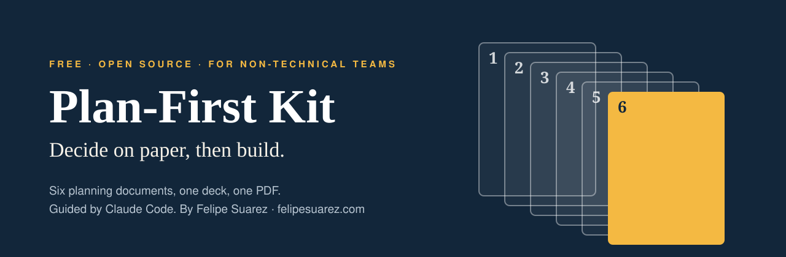
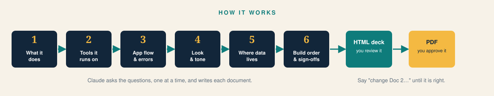
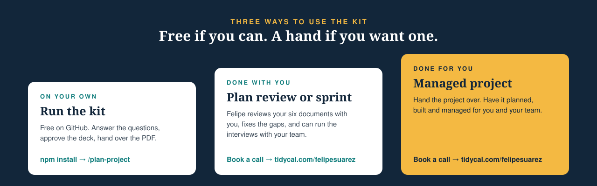

<p align="center"></p>

# Plan-First Kit

**Most website, portal and app projects go wrong before anyone writes a line of code, because nobody wrote down what was being built.**

The Plan-First Kit fixes that. You run one command. Claude asks you plain-English questions, one at a time, and writes **six planning documents** for you. Then it builds a **letter-size deck** so you can read them all in one place, change anything, and approve it. When you say "approved", you get a **PDF** to hand to whoever builds your project: a freelancer, an agency, your own team, or an AI coding tool.

It works for websites, client portals, internal tools, apps and SaaS products. No technical knowledge needed.

<p align="center"></p>

[](https://www.youtube.com/watch?v=hqhOmhOoFiQ)

## The six documents

| # | Document | The question it answers |
|---|---|---|
| 1 | Product requirements | What does it do, feature by feature? |
| 2 | Technical requirements | What is it built on, so nobody guesses halfway through? |
| 3 | App flow | Which page comes next, and where do people land when something goes wrong? |
| 4 | Design brief | How does it look and sound, so every screen is on-brand? |
| 5 | Backend schema | Where does your data live, and who can see it? |
| 6 | Implementation plan | What gets built in what order, and where do you sign off? |

Each document is built from the ones before it. At the end you get a six-box check you can use to decide whether building can start.

## Quick start (about 10 minutes to set up)

You need a computer with a terminal, and a Claude account that can use [Claude Code](https://docs.claude.com/en/docs/claude-code).

1. **Install Node.js** (version 18 or newer) from [nodejs.org](https://nodejs.org).
2. **Install Claude Code** by following the [official instructions](https://docs.claude.com/en/docs/claude-code).
3. **Download this kit.** Click the green **Code** button on GitHub, choose **Download ZIP**, and unzip it. Or run `git clone`.
4. **Open a terminal in the kit's folder** and run:

   ```bash
   npm install
   npm run setup
   ```

5. **Start Claude Code** in that folder and type:

   ```
   claude
   /plan-project
   ```

That's it. Claude takes it from there. A full run takes about 45 to 60 minutes, and you can stop and come back: `/plan-project` picks up where you left off.

> **Not comfortable with a terminal?** There is a version for Claude Projects with no installation at all. See [Prefer not to use a terminal?](#prefer-not-to-use-a-terminal) below.

## What happens when you run it

1. **Setup.** Claude asks for your project name, your name, and optionally your company and logo. It generates a clean typographic cover for you. If you'd rather use your own cover image, attach it in the chat. You can create one outside Claude with an image generator, stock imagery, or Canva.
2. **Six short interviews.** One question at a time, each with an example answer so you can see what good looks like. Say **suggest** and Claude proposes something for you to edit. Say **show me an example** and Claude shows how the sample business answered.
3. **A consistency check.** A second pair of eyes reads all six documents against each other and flags gaps, such as a feature with no page, or a page that shows data the wrong person shouldn't see.
4. **The deck.** Open `projects/<your-project>/deck.html`. View one document or all six, with your name, project name and logo on every page.
5. **Review and change.** Say things like *"Change Doc 2: we use Square, not Stripe"* and the deck is rebuilt. Repeat until it is right.
6. **Approve and export.** Say *"approved"* and Claude renders the PDF.

Everything lives in `projects/<your-project>/`, and it stays on your computer.

## See what good looks like

A complete, invented example is in [`examples/tidewater-pottery/`](examples/tidewater-pottery/): a pottery studio that wants class booking, memberships and a "where is my piece?" tracker. Read it before you start, or build its deck and PDF to see the finished result:

```bash
npm run example
npm run pdf -- examples/tidewater-pottery
```

## Commands

| Command | What it does |
|---|---|
| `/plan-project` | The whole workflow, start to finish. Resumes where you stopped. |
| `/doc 3` | Start, continue or redo one document (1 to 6). |
| `/build-deck` | Rebuild the deck. |
| `/export-pdf` | Export the approved deck as a PDF. |
| `/status` | See what's done and what's next. |
| `/review` | Check the six documents against each other. |

## Prefer not to use a terminal?

There is a no-installation version that runs inside a Claude Project (or as a Claude Skill) and produces the same six documents and a printable deck. Get it at [Plan First Skill](https://store.felipesuarez.com/plan-first-kit).
<!-- TODO: replace with the dedicated email-capture subdomain URL for this kit -->

## Need a hand?

The kit is free and always will be. If you would rather not do it alone, I can help.

<p align="center"></p>

- **Plan review.** You run the kit; I review your six documents with you on a call and send written fixes.
- **Done with you.** A planning sprint where I run the interviews with you and your team.
- **Done for you.** I plan, build and manage the project for you and your team.

**[Book a call with Felipe](https://tidycal.com/felipesuarez/30-minute-discovery)**: a short form first, so I come prepared.

If you want to learn the whole method on video, working through one project start to finish, the tutorial is coming soon.
<!-- TODO: add the paid video tutorial link here -->

## How it works under the hood

For the curious, and for anyone adapting it:

- `CLAUDE.md` tells Claude how to run the workflow: the order, the interview rules, the approval loop.
- `kit/doc-specs.md` holds the questions, example answers and required structure for each document.
- `.claude/commands/` holds the slash commands. `.claude/agents/consistency-reviewer.md` is the one subagent, used only for the final cross-check. The interviews run in the main conversation because they need you.
- `scripts/` holds small Node scripts that create a project, validate the documents, build the deck and export the PDF.
- `templates/deck.css` is the deck's look. Change the colours and fonts there to make it yours.
- `kit.config.json` holds the creator name, links and footer text that appear in the deck.

## License

Code, templates and documentation are [MIT licensed](LICENSE). Use them, change them, share them, including inside your company. The Plan-First Kit name, the Felipe Suarez name, and the artwork in `assets/` are not part of that license; see [TRADEMARKS.md](TRADEMARKS.md).

---

<p align="center">Made by <a href="https://felipesuarez.com">Felipe Suarez</a> · 15 years of shipping web and e-commerce projects for global teams.</p>
